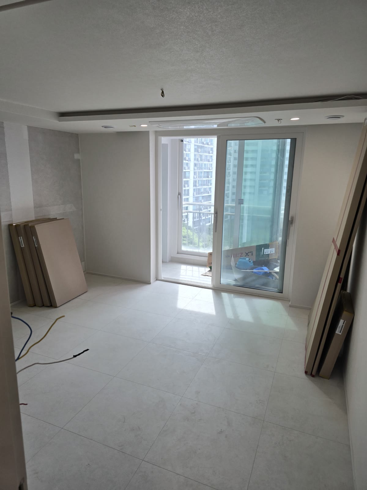
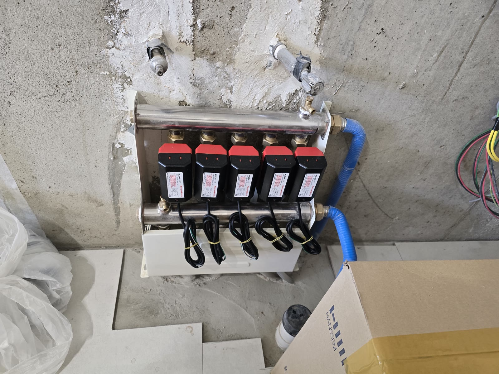
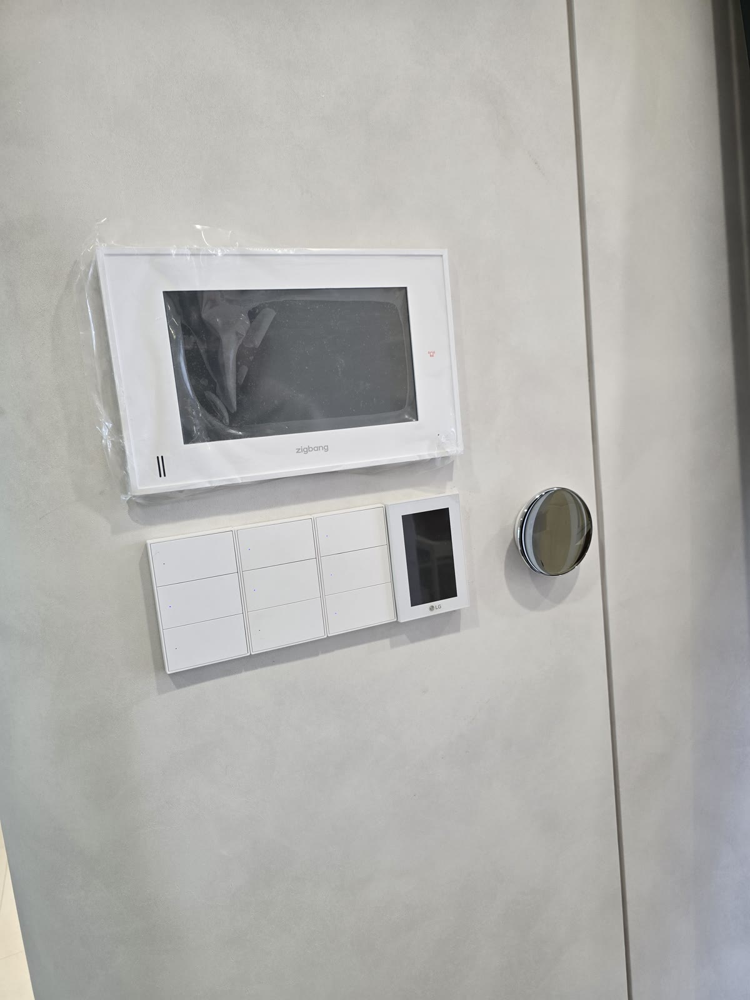
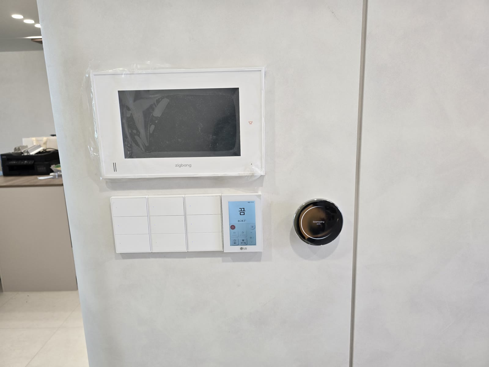
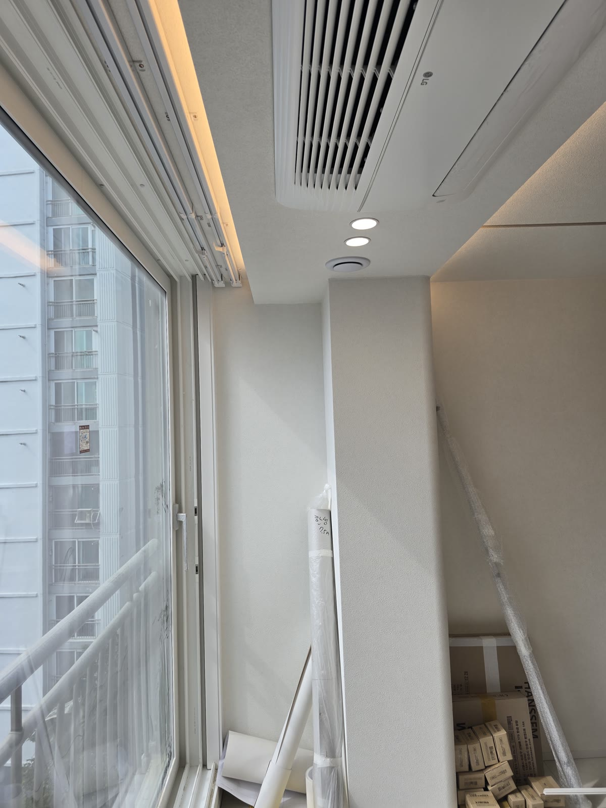

# 방마다 난방 온도, 따로 맞추면 뭐가 달라질까요? | 관악구 아파트 집들이

관악구의 한 아파트예요. 리모델링 공사를 하면서 스마트홈 공사를 같이 했어요.
이 집은 가족마다 좋아하는 온도가 달랐어요. 아이 방은 따뜻하게, 안방은 조금 선선하게.
그래서 방마다 난방 온도를 따로 맞추는 쪽으로 설계했어요. 28초 영상으로 먼저 보시면 감이 올 거예요.

https://youtu.be/857YL0GMgeY

## 한 집에 사는데, 원하는 온도는 다 달라요

아파트 난방은 보통 거실 온도조절기 하나로 집 전체를 켜고 꺼요.
아이 방을 따뜻하게 하려고 올리면 안방까지 더워지고, 안방에 맞추면 아이 방이 서늘해요.
결국 한쪽이 참거나, 하루에도 몇 번씩 조절기 앞을 오가게 돼요. 이 집도 같은 고민이 있었어요.

## 방마다 온도조절기를 하나씩 달았어요

아파트 바닥난방은 분배기에서 방별로 온수 배관이 갈라져요.
이 분배기의 밸브마다 전동 구동기를 붙이고, 방마다 온도조절기를 하나씩 달았어요.
안방 조절기를 올리면 안방 밸브만 열리고, 아이 방 조절기를 올리면 아이 방 밸브만 열려요.

조절기는 다이얼형(구글 네스트)이에요. 돌리면 올라가고, 반대로 돌리면 내려가요.
설명 없이 쓸 수 있어서 부모님이 오셔도 걱정이 없어요. 앱과 음성은 그다음이에요.

조명 스위치도 같이 스마트 스위치로 바꿨어요. 벽에서 누르는 건 그대로이고, 폰과 음성이 더해진 거예요.
방마다 월패드, 스마트 스위치, 온도조절기를 한 벽면에 나란히 두어서 한눈에 들어와요.
이 집에서는 "헤이 구글, 거실 불 꺼 줘"로 거실 간접조명을 끄는 장면도 찍었어요.

## 입주하고 나서는 이렇게 써요

- 아이 방은 조금 높게, 안방은 낮게 두고 각자 다이얼로 맞춰요
- 폰 앱에서도 방별 온도를 보고 바꿀 수 있어요
- 누워서 "불 꺼 줘" 한마디로 거실 불을 꺼요

## 이 집에서 배운 것 하나

난방 각방 제어는 **공사 중에 정하면 쉽고, 입주 뒤에 하면 번거로워요.**
분배기 구동기와 조절기 배선이 벽과 천장 안으로 들어가야 하는데, 그 시점이 대개 목공 전이거든요.
입주한 뒤에 하려면 벽을 다시 열거나 배선을 밖으로 돌려야 해서 비용과 모양 모두 손해예요.
리모델링을 계획 중이라면 "난방을 방마다 따로 할지"를 인테리어 실장님과 첫 미팅 때 같이 정해 두세요.
이 집처럼 영상 한 편 길이의 결과를 얻으려면, 결정은 공사 전에 끝나 있어야 해요.

비슷한 고민이 있으시면 스타트홈 홈페이지의 '바로 AI견적 받아보기'에서 평수와 공사 상태만 넣어 보세요.
